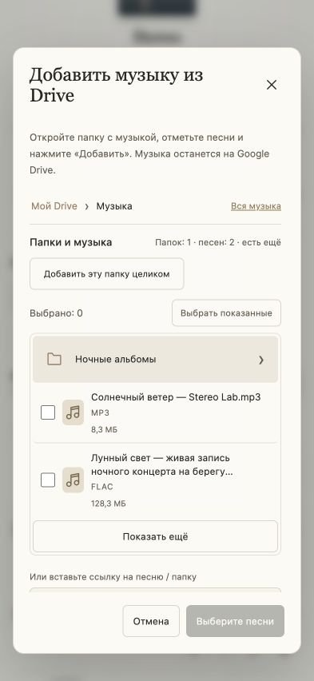

# Tape Room 1.2.14 — полный аудит и мобильные окна

11 октября 2026. Исправления внесены в исходники и применены штатным менеджером к локальной CMS: 1.2.13 → 1.2.14, статус active сохранён. Установленная версия дополнительно подтверждена в браузере. На maxipapa.ru этот выпуск в рамках данной проверки не установлен и не опубликован в GitHub.

## Подтверждённые причины и исправления

| Причина | Исправление и место |
| --- | --- |
| Высота окна Drive не учитывала безопасные отступы и уменьшение видимой области при клавиатуре. | `assets/player.js:493`, `assets/player.css:246`: высота и смещение VisualViewport, safe-area, ограничение окна, прокрутка полей; на крайне малой высоте прокручивается всё окно. |
| Закреплённый путь папок перекрывал сфокусированное поле на малой высоте. | В компактном окне путь прокручивается вместе с содержимым. На телефоне список файлов и поля используют одну прокрутку; нижние действия сохраняются. |
| Узкие панели, действия трека и длинное название могли пересекаться. | Переносы для 280–480 px, отдельное место действиям плейлиста, увеличенный отступ перемотки на 481–760 px. `assets/player.css:236`. |
| Недостаточный контраст вторичных надписей в светлой теме. | Контраст подписей, видимый фокус поиска и доступные имена диалога/загрузки. `views/player.php`, `assets/player.css:236`. |
| Сохранённый JSON `null` останавливал запуск плеера. | Проверка типа восстановленного состояния. `assets/player.js:19`. |
| Единственная песня при Shuffle могла повториться при выключенном Repeat. | Автоматическое окончание останавливается; удалённая из коллекции текущая песня не мешает перейти к оставшейся. `assets/player.js:435`. |
| Пауза, перемотка и сворачивание исчерпывали попытки подготовки Drive без сетевых ошибок. | Намеренная отмена возвращает активную попытку; реальные сетевые ошибки сохраняют ограниченные повторы. `assets/preload.js:30`. |
| Запоздалый ответ Drive заменял новое окно или показывал ошибку после закрытия. | Поколение запроса и браузера папок отменяет устаревшие результаты. `assets/player.js:819`. |
| Refresh и отключение могли перезаписать личное подключение; старый 401 портил свежий access token. | Одна приватная блокировка на изменение аккаунта; 401 отменяет только соответствующий токен. `src/Services/GoogleDrive.php:173`, `:210`. |
| Поздний OAuth callback из другой сессии восстанавливал отменённое подключение. | Сохраняемая метка отмены проверяется до обмена кода и перед записью под блокировкой. Новый явно начатый вход работает. `GoogleDrive.php:56`, `:81`, `:112`. |
| Новый Client ID с пустым Secret сохранял секрет прежнего клиента. | Смена клиента требует соответствующего нового секрета до изменения рабочих настроек. `GoogleDrive.php:29`. |
| Одновременный импорт одного файла приводил к ошибке уникального ключа. | Атомарный MySQL upsert возвращает существующий ID, сохраняет название, обложку, избранное и состав плейлиста. `src/Repositories/Library.php:107`. |
| Удаление idle lock могло создать две независимые блокировки одной загрузки. | Постоянный ограниченный пул из 256 слотов на аккаунт и отдельная блокировка подготовки. Коллизия пропускает необязательную подготовку. `src/Services/DriveCache.php:94`. |
| Одновременная смена обложки и удаление оставляли файл без записи. | Актуальная строка читается под FOR UPDATE; изменение и удаление завершают транзакцию до очистки файлов. `src/Repositories/Library.php:153`, `:180`. |

Симметричные катушки из 1.2.13 сохранены. Основной HTML Audio независим от индикаторов; реальные L/R не заменяются случайной анимацией. Подтверждённой новой ошибки в движке `meters.js` эта итерация не выявила, поэтому его архитектура не изменена.

## Результаты проверок

| Проверка | Результат |
| --- | --- |
| Unit PHP | 88 прошли |
| DriveStream / DriveCache | 67 прошли |
| Библиотека на реальной локальной MySQL | 36 прошли, включая конкурентные соединения |
| Node audio.js | Прошли: 20 автоматических/20 быстрых переходов, состояния контекста, ошибки, зависший resume, поздние callback, буферизация, тишина, Media Session, независимость основного звука |
| Node preload.js / animation.js | Прошли: отмены, очередь Shuffle/Repeat, offline/reconnect, ограниченные повторы, геометрия, 120 Hz, reduced motion |
| Корневой tests/tape-room-ui.js | Прошли: некорректное сохранённое состояние, клавиатурные размеры, поздние ответы/ошибки Drive |
| PHP / JS синтаксис | 13 PHP-файлов и 4 JavaScript-файла без ошибок; shell launcher проверен |
| Установочный архив | 26 файлов, содержимое каждого побайтно совпадает с исходниками; CRC, версия и SHA-256 проверены |

Браузер Chromium в Codex, контролируемый аудиопоток через настоящий DriveStream/DriveCache с локальным upstream:

- 56 автоматических переходов через captureStream, 20 быстрых ручных переключений; один AudioContext, ноль ошибок анализатора и основного аудио.
- 52 автоматических перехода через принудительную аудиокопию и 20 быстрых ручных переключений; один AudioContext и одна сохраняемая копия, ноль ошибок и пересозданий.
- Stereo, Mono, Quiet и настоящий Zero: разные уровни L/R, одинаковые каналы Mono и нулевой RMS в тишине. На завершённых автоматических звуковых дорожках пропусков первого сигнала не было. Исходное восстановление песни на паузе исключено из этой оценки.
- На capture-пути первый сигнал после перехода: медиана около 172 мс, максимум 248 мс. Это измерение тестовых двухсекундных WAV, не скорость настоящего Google Drive.
- В предыдущем длинном браузерном запуске две песни одновременно загружены, обе сразу получили длительность 0:04 и доступное воспроизведение; обложка и длинное название сохранены через API.
- Создание плейлиста, добавление песен, избранное, сортировка и переходы по папкам проверены через UI. Выбор сохранялся при переходе в подпапку, повторная страница не дублировала файл.
- Сортировка открывается поверх списка: документная координата первого ряда до/после открытия одинаковая (965,5 px).
- Mute показывает громкость 0; unmute возвращает 0,8.
- На ширинах 280, 393, 481, 760 и 1280 px горизонтального переполнения нет; настройки, тема, Shuffle, Repeat и Mute имеют равные ширину/высоту и радиус 50%.
- Длинное название при 481 px: низ исполнителя 330,46 px, верх перемотки 351,05 px — промежуток 20,59 px.

## Мобильное окно

Проверена модель safe-area 59 px сверху и 34 px снизу:

| Видимая область | Верх / низ окна | Результат |
| --- | --- | --- |
| 393×852 | 59 / 818 px | Заголовок и нижние кнопки видны, поля прокручиваются |
| 393×740 | 59 / 706 px | Светлая и тёмная темы помещаются |
| 393×352, клавиатурная модель | 59 / 318 px | Поле ссылки доступно при фокусе; кнопки 257–297 px |
| 280×240 | 59 / 206 px | Есть прокрутка всего окна; отмена и пояснение удаления доступны |

[Тёмная тема](drive-mobile-dark.png), [поле на уменьшенной высоте](drive-keyboard-focused.png), [длинное название](long-title-481.png).

Диагностические данные: [автоматические переходы](automatic-transitions.json), [ручные](manual-transitions.json), [копия](mirror-transitions.json), [ручные через копию](mirror-manual-transitions.json), [адаптивность](responsive.json). Детали: [сервер](server-audit.md), [аудио](audio-audit.md).

## Google Drive и границы проверки

Range 0–1 для Safari, suffix/open-ended/416, fallback 200, точная склейка кэша и остатка одной ревизии, 401/403/404/429/500, обрыв потока, ограничение кэша и разделение пользователей проверены контролируемыми сценариями реальных сервисов. Рабочие OAuth-файлы и песни пользователя не читались и не изменялись.

Доступный агентский аккаунт локальной CMS пока имеет пустую библиотеку и ненастроенный Drive. Пользователь сообщил, что войдёт в Google Drive в браузере Codex позже. Поэтому настоящий OAuth, папки и песни его аккаунта, большие FLAC, скорость внешнего Google и физический iPhone / Safari / PWA ещё требуют живой проверки. Chromium с принудительной копией не считается проверкой WebKit или системной блокировки экрана. Реальный телефонный тест остаётся отдельным этапом после входа пользователя.

## Обновление и проверка на iPhone

Локально обновление уже применено. Для maxipapa.ru пакет находится в `dist/reel-player-1.2.14.zip`. В штатном центре обновлений версия появится после публикации каталога `plugins/reel-player` в настроенную ветку main репозитория. Публикация в этой проверке не выполнялась.

При ручном переносе заменяется только каталог `plugins/reel-player` из архива; база и `storage/reel-player` сохраняются. После переноса нужно штатно завершить обновление metadata/manifest через PluginManager::completeUpdate('reel-player') и проверить версию внизу плеера. Не требуется вводить OAuth-реквизиты заново, если сам Google доступ остаётся действующим.

На iPhone закройте PWA полностью и откройте снова; убедитесь, что внизу 1.2.14. Откройте Drive с папкой из 19+ песен: заголовок, закрытие и нижние действия должны помещаться, а содержимое прокручиваться. Коснитесь ссылки, проверьте доступность поля и кнопок над клавиатурой, затем поверните телефон. В Safari и PWA проверьте первый Play, автоматический/ручной переход, перемотку, паузу, блокировку и возврат. При повторном сбое сохраните локальный отчёт кнопкой версии: он не содержит названий песен, URL или токенов.

## Изоляция

Новые сценарии и helpers — в корневой tests/. Временные данные — только в собственных каталогах tests/.tmp/, скриншоты и отчёты — здесь. SQLite adapter стенда обновлён для эквивалентного MySQL upsert и отдельно проверен через настоящий Library. Производственные пользовательские данные не использовались как фикстуры; фоновые тестовые процессы остановлены после проверки.

SHA-256 пакета: `ec3f19b3718f7333e49528637cc181caa1b827eec3889abca6ac3f7c037a6af4`.
